<picture>
  <source media="(prefers-color-scheme: dark)" srcset="assets/icon/openmcm2-worn.png">
  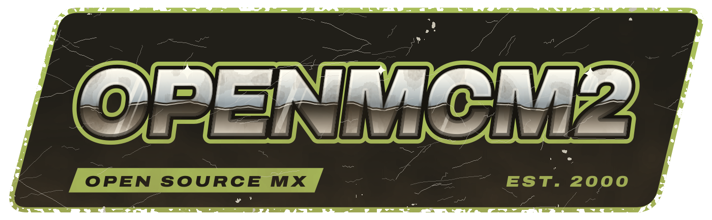
</picture>

# OpenMCM2

An open-source engine for Motocross Madness 2 (Rainbow Studios, 2000),
written from scratch in Rust from a study of the original game. It runs
natively on macOS (Metal), Windows (DX12/Vulkan) and Linux (Vulkan).

**This repository contains no game files.** Like OpenMW, the engine reads the
tracks, models, textures, sounds and menus from a copy of the game that you
own. Point it at the folder of your install (or the CD's `GAME` folder).
**No copy? Play with the free graphics** (see below).

Project page: https://crspytopgn.github.io/openmcm2/ · Play in your browser: https://crspytopgn.github.io/openmcm2/play/ · Tools: https://crspytopgn.github.io/openmcm2/tools/

## New in 0.8: The Big Physics Update

**It rides like MM2 again.** Grip, suspension, jumps, landings and crashes
now feel just like the original, at any frame rate, and the cameras and
computer riders are back the way they were. Plus it runs faster, the free
bikes have new audio, and Course Builder tracks export to the original
game. See [RELEASE_NOTES.md](RELEASE_NOTES.md) for the full list.

## New in 0.7

| | |
|---|---|
| 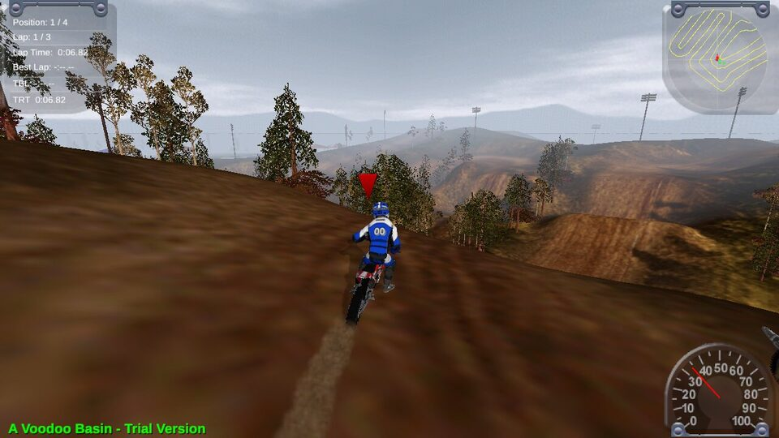 | 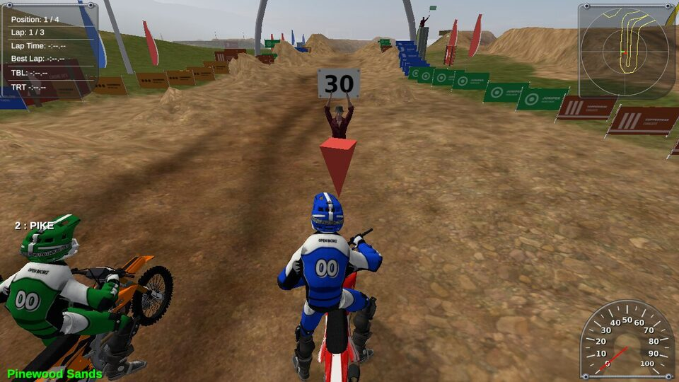 |
| **Start with the free MM2 demo.** No copy of the game? The launcher and the browser page fetch Microsoft's free 2000 demo for you. Its two tracks play with the original graphics and menus, and the Free Pack opens up everything else. | **Free mode, closer to the original.** The 30-second board man, the finish arch and flag girl, a race display in the original's style, and ten more free tracks. |
| 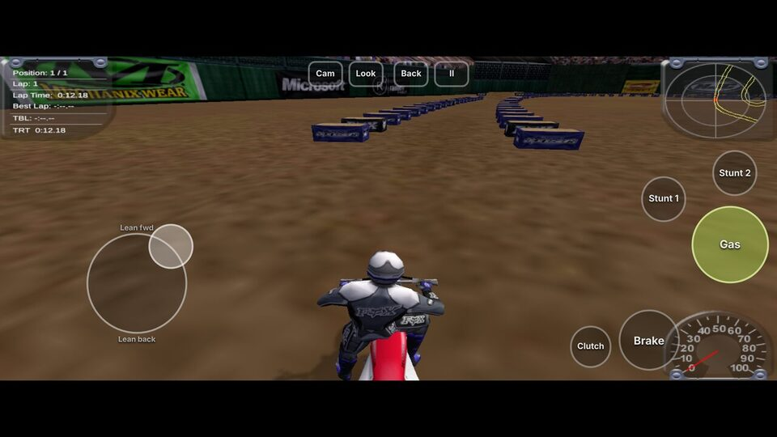 | 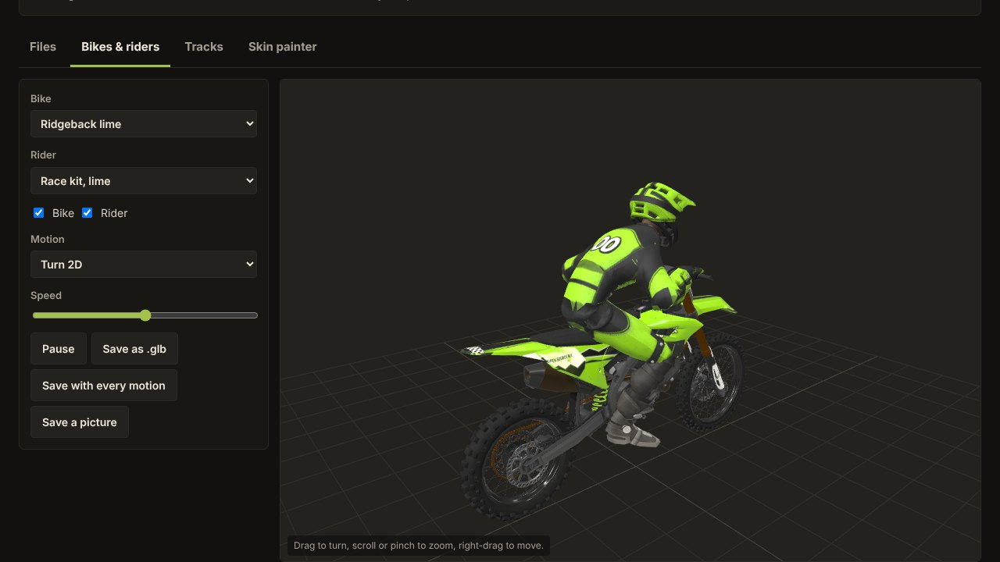 |
| **Phones and tablets.** Touch controls in the browser, a light mode for phones, Add to Home Screen, and it starts offline once played. | **The [Tools page](https://crspytopgn.github.io/openmcm2/tools/).** Browse the game's files, turn the bikes and riders through every animation, fly round tracks and paint your own skins. |
| 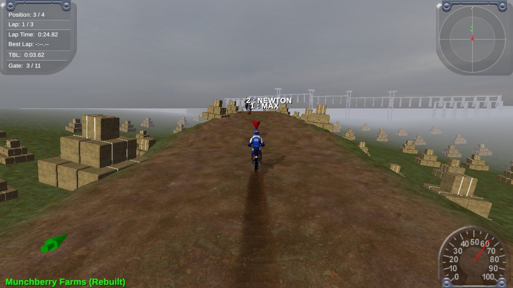 | 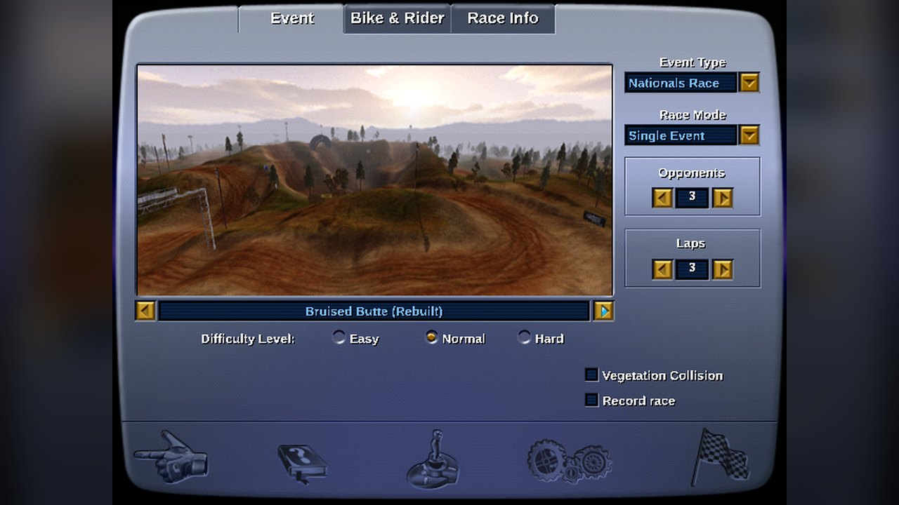 |
| **The demo's other tracks, rebuilt.** The MM2 demo lists 27 more tracks it won't let you ride. Turn on **Rebuilt demo tracks** in Extras and each one is rebuilt on new ground the first time you ride it, with its own route, scenery and pictures. | **In the original menus.** The rebuilt tracks sit with the demo's own in each event's list, marked "(Rebuilt)". |

Also new: **photo mode** and **race the leaderboard ghosts** (both in Extras, off by default), a steadier frame rate on every preset (Ultra runs far better on a 4K TV), smoother computer riders, wrecks that tumble like the original's, pad rumble in the browser, a real idle for the free 125 and an out-of-bounds slide whistle. See [RELEASE_NOTES.md](RELEASE_NOTES.md) for the full list.

## Build your own tracks

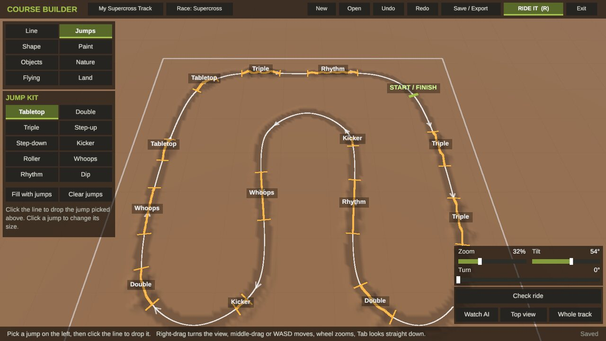

The **Course Builder** is on the main menu. Draw the line, drop in jumps,
whoops and rhythm sections, paint sand and mud, add bales, tents and
trailers, then press **Ride it** and you're racing your own track. *Surprise
me* makes a whole track in one click, and you can start from a copy of any
track you already have. It's free, works with either set of graphics, and
runs in the browser too. (A switch in the launcher's Extras takes it off the menu.)

## The Tools: look inside the game

| | |
|---|---|
| 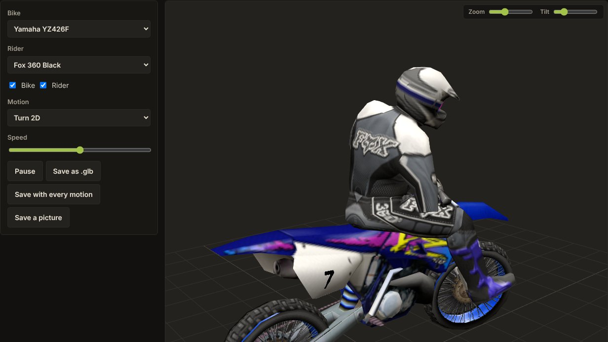 | 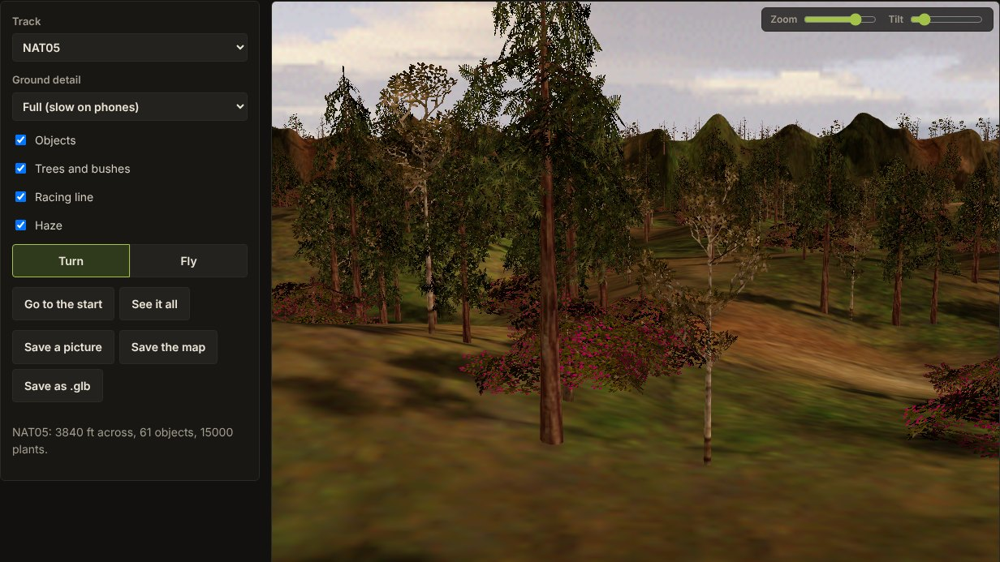 |
| **Bikes & riders.** Every bike and rider in 3D, in any paint and outfit, playing every animation the game has. | **Tracks.** Fly round any track with its scenery, trees and racing line, your own tracks too. |
| 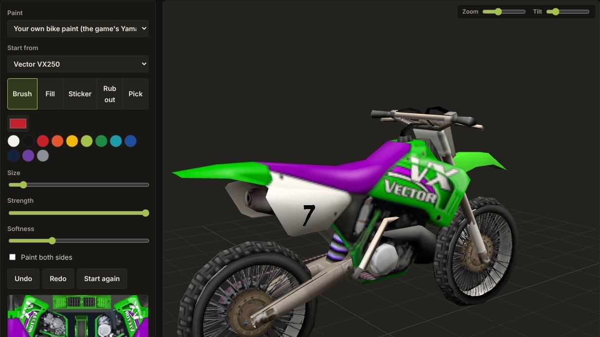 | 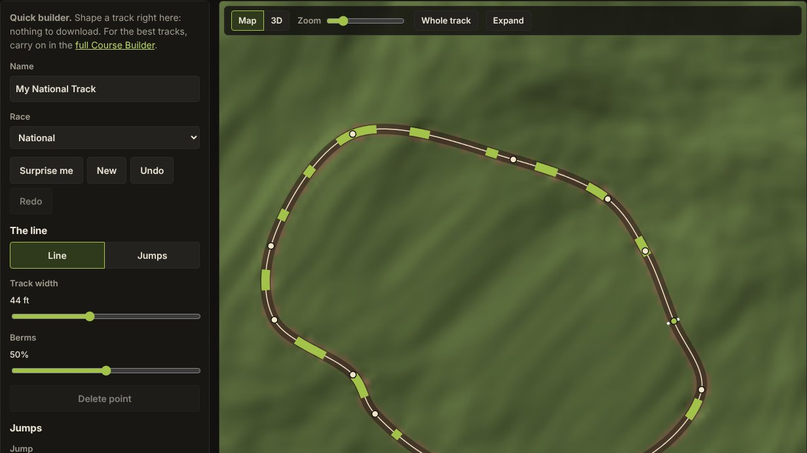 |
| **Skin painter.** Paint a bike or a rider right on the 3D model and save it as a `.tga` for your game. | **Quick Course Builder.** Shape a track in seconds, then ride it or carry on in the full Course Builder. |

The **[Tools page](https://crspytopgn.github.io/openmcm2/tools/)** runs in
any recent browser, nothing to install. Point it at your MM2 folder, CD or
`.zip`, or the Free Pack, and browse every file with previews, save models
as `.glb`, pictures as `.png` and sounds as `.wav`. Your files are read on
your own computer and never uploaded. More on each tool [below](#tools).

## Hidden extra: drive the scenery

| | |
|---|---|
| 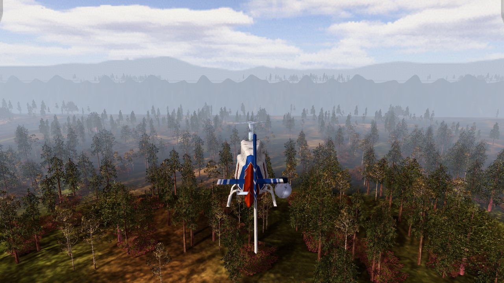 | 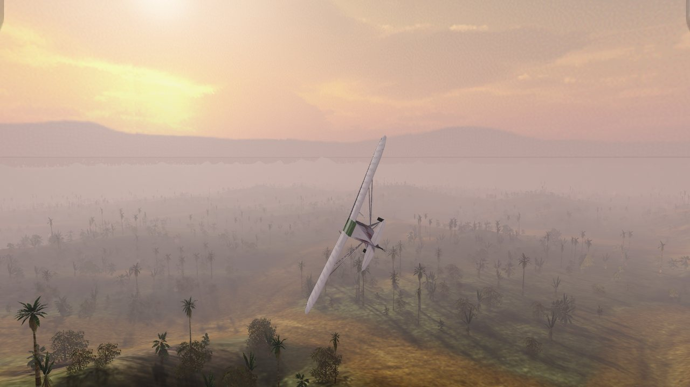 |
| 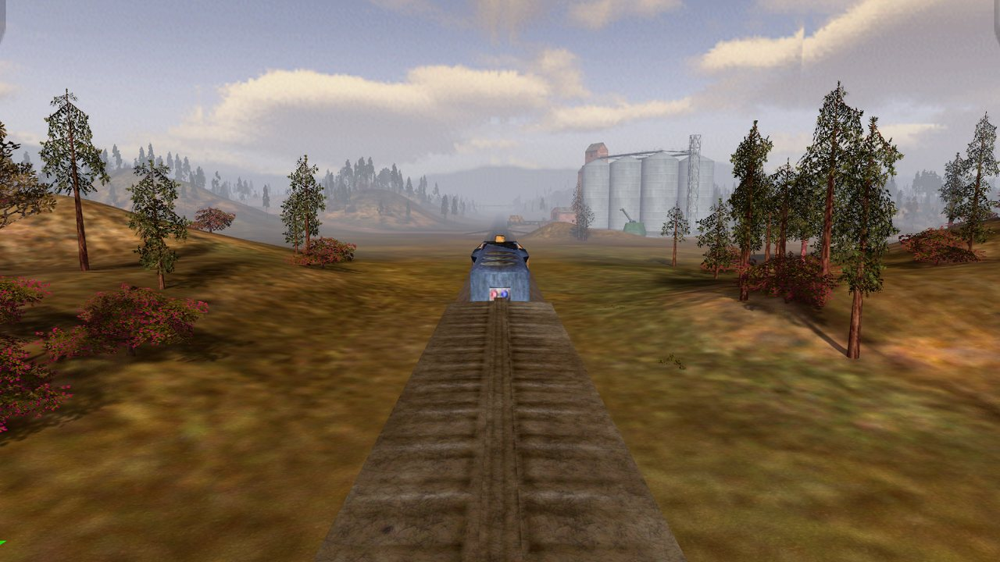 | 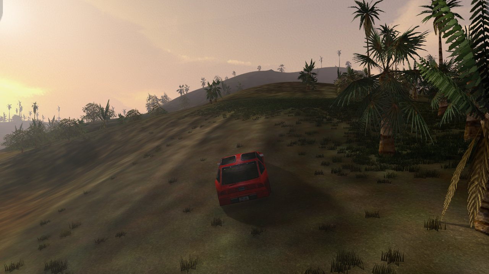 |

The cars, trucks, trains, planes and helicopters on the tracks aren't just
scenery. Turn on **Drive the scenery** in Extras, go to Practice or free
roam, and press **V** (or down on the D-pad) next to one to get in, or
anywhere to grab the nearest plane, helicopter or blimp in the sky. Each has
its own springs, weight, power and engine sound. Press **V** again to hop
back on your bike. The Enduro tracks have the most, and the free tracks have
a car park by the start plus planes, a helicopter, a blimp and a UFO. Works
in the download and the browser.

## No copy of MM2? Play with the free graphics

| | |
|---|---|
| 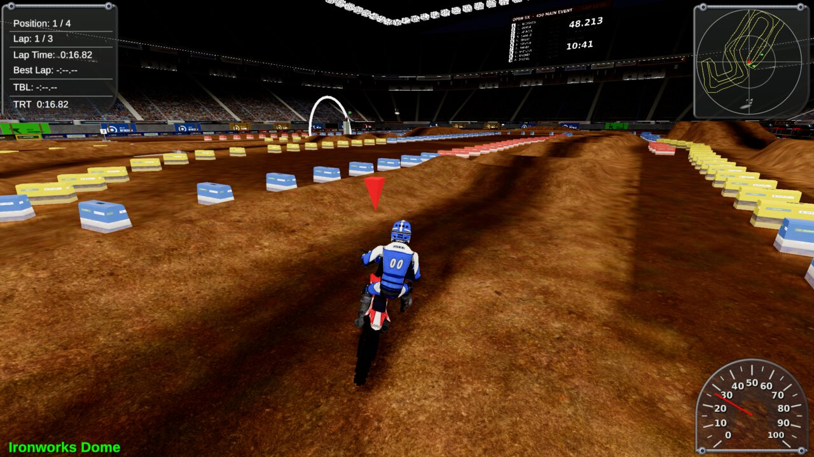 | 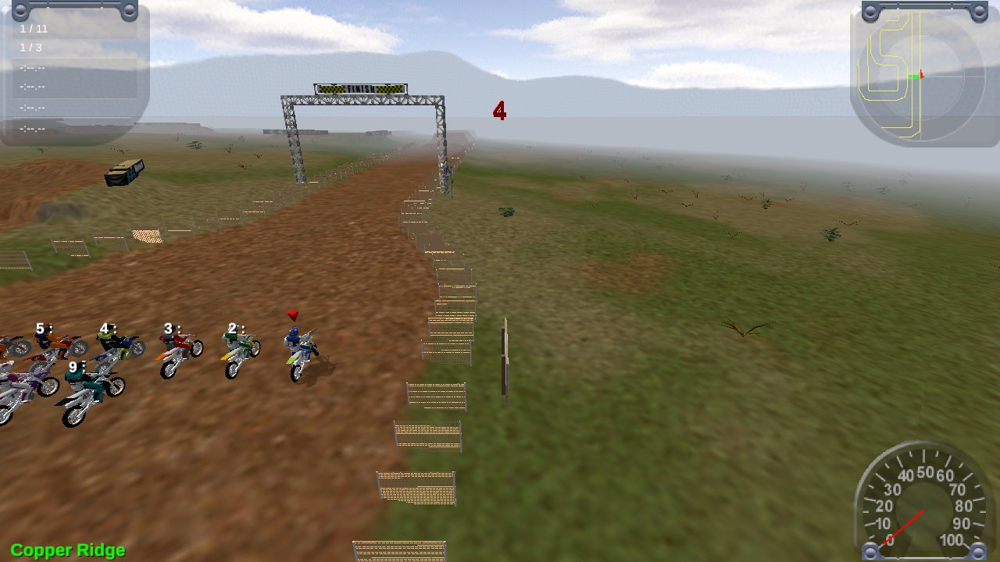 |

The **Free Pack** is a whole set of new art made for OpenMCM2: bikes and
riders, a supercross stadium with lights for night races, 38 new tracks
across every event, skies, trees, trucks and planes. It's all our own work or
openly licensed (see [freepack/CREDITS.md](freepack/CREDITS.md)), so anyone
can download it and ride. The launcher and the browser page both ask
**MM2 graphics or free graphics?** when you play, and fetch the pack for you,
downloading only what changed when it updates.

With no MM2 files at all you still get the whole game: every menu, single
races on the free tracks, a Pro Circuit career, and the Course Builder. The
menus wear a **new look**: the same screens and buttons as the original,
redrawn. Own the game? Pick **New look** or **Original menus** beside the
graphics choice. The new look with your own MM2 graphics needs only the
menus, a small download, not the whole Free Pack.

**Or try the original look with the free demo.** Microsoft gave away a
Motocross Madness 2 demo in 2000, and the Internet Archive still keeps it.
Press **Get the free MM2 demo** in the launcher, or **Play the free MM2
demo** on the browser page, and OpenMCM2 fetches it from there (43 MB),
checks it and plays its two tracks, Voodoo Basin and Donner Pass, with the
original graphics. The Free Pack fills in every other track, bike and
screen, so every event is open. The demo never comes with OpenMCM2 itself.
For the demo's other tracks it keeps only the route and the scenery, so the
**Rebuilt demo tracks** extra (off unless you turn it on) lays new ground
under them: the original route and scenery, with hills and jumps of our own.

[](https://youtu.be/rP0TEnWLzNo)

Watch the showcase video: https://youtu.be/rP0TEnWLzNo

## How it's made

OpenMCM2 is one fan's project, written with the help of an AI coding
assistant (Claude Code) and tested ride by ride against the original game.
Bug reports, reviews and contributions are very welcome.

## Support the project

OpenMCM2 is free and always will be. Making it has real monthly costs,
though. If you enjoy it, a small donation helps cover them and pays for
future updates.

**[♥ Buy me a coffee on Ko-fi](https://ko-fi.com/crspytopgn)** · **[Sponsor on GitHub](https://github.com/sponsors/crspytopgn)**

More from me: [OpenSGolf](https://github.com/crspytopgn/opensgolf) · [OpenLinks2003](https://github.com/crspytopgn/openlinks2003) · [Pitwall](https://github.com/crspytopgn/pitwall).

## Playing

Download a release and start **OpenMCM2** (`OpenMCM2.app` on a Mac,
`mm2-launcher` on Windows and Linux). The first time, point it at your own
copy of Motocross Madness 2: a CD image (`.iso`, `.bin`/`.cue`, `.img`,
`.mdf`/`.mds`, `.nrg`), the CD itself, the folder it is installed in, or a
`.zip` of any of these. It copies
the game's `GAME` folder into the port's user folder
(`~/Library/Application Support/MM2/GAME` on a Mac, `%APPDATA%\MM2\GAME` on
Windows, `~/.local/share/mm2/GAME` on Linux). Then pick the look, effects,
full screen, window size and vsync, and press Play. The game itself is
never downloaded (only Microsoft's free demo, from the Internet Archive,
when you ask for it): OpenMCM2 ships without any game data.

**On Linux, a Steam Deck or a Steam Machine**, the `.AppImage` download is
the whole thing in one file: make it executable and open it. To play it
from Steam's Gaming Mode, with library pictures and controller tips, see
[docs/steam-deck.md](docs/steam-deck.md). `mm2-launcher --play` (or the
AppImage with `--play`) skips the launcher and starts the game with the
saved settings.

**More tracks.** The launcher's Get tracks section lists the player-made
tracks on [MDX Racing](https://mdxracing.com) and, only for the ones you
pick, downloads the zip from there and adds its track to the game
(`tracks.ini` in the user folder records them, so Remove takes them out;
a track never replaces a file it didn't add). Tracks only offered as
`.rar` link to the site instead.

The game can also be started directly with its folder, from a terminal:

```sh
./mm2-viewer "/path/to/Motocross Madness 2"
```

Started with no folder, `mm2-viewer` uses the launcher's copy of the game
(or a game folder it is run from). `mm2-launcher --import <image or folder>`
does the setup without a window. To build it yourself, install Rust from
https://rustup.rs, then:

```sh
cargo build --release -p mm2-viewer -p mm2-launcher
./target/release/mm2-launcher
```

On a Mac, `sh tools/make-mac-app.sh` builds `target/release/OpenMCM2.app`.

### In a browser

OpenMCM2 also runs in a browser with WebGPU (a recent Chrome or Edge, or
Safari 26): **https://crspytopgn.github.io/openmcm2/play/**. With no copy
of the game, pick **Free graphics** and it plays with the Free Pack,
downloaded once into that browser. Or play from your own copy: pick your
installed game folder, your CD, a CD image (`.iso`, `.bin`, `.img`,
`.mdf`, `.nrg`) or a `.zip`, or drop it on the page. The files are read
on your computer and never uploaded, and the page holds no game data. It
can remember your game in that browser, saves stay there too, and once
played it starts without the internet. Phones and tablets with no mouse
get touch controls (a thumb stick to steer and lean, gas and brake,
stunts and the camera) and a light mode that keeps a phone smooth. Add the
page to your Home Screen to play full screen; on iPhone and iPad the Home
Screen copy keeps its own storage, so you pick your game files or download
the Free Pack once more there. If something goes wrong, the start page and
the loading screen copy a bug report to paste into an issue. Network races
work between browsers and desktops alike: the host gets a race code and
an invite link to share, and races show in everyone's server browser. To build it
yourself:

```sh
rustup target add wasm32-unknown-unknown
cargo install wasm-bindgen-cli --version 0.2.129   # the wasm-bindgen in Cargo.lock
sh tools/build-web.sh
python3 -m http.server -d web 8000                 # then open http://localhost:8000
```

### Tools

The site's **[Tools page](https://crspytopgn.github.io/openmcm2/tools/)**
runs in any recent browser (no WebGPU needed) on the same file readers as
the game, built small for the web (`crates/mm2-webtools`):

- **Files**: look through every file of your game, its CD image or the
  Free Pack, archives opened like folders, with previews of models,
  pictures, sky boxes and sounds. Save models as `.glb` (with their
  animations), pictures as `.png` and sounds as `.wav`.
- **Bikes & riders**: the bikes and riders in 3D with their paints,
  outfits and every motion the game has (and the Free Pack's own).
- **Tracks**: any track's ground, objects, trees, sky and racing line,
  with free fly. Add tracks of your own, such as MDX Racing's.
- **Skin painter**: paint a bike or a rider in 3D and save it as a `.tga`
  for your game's `BIKES` or `RIDERS` folder (the browser version can
  keep it too), or a Free Pack paint as a `.png`.

Your files are read in the browser and never uploaded. To try it locally:
`sh tools/build-web-tools.sh`, copy `web/*.js` into `site/play/`, then
`python3 -m http.server -d site 8000` and open http://localhost:8000/tools/.

Options go in the address: `?enhanced` for the enhanced look.

It opens the original front end: profiles, the main menu, single player and
its event screens, Bike & Rider, options, the Pro Circuit career, replays and
network races between copies of OpenMCM2. Every event the original has is
in: Supercross and National races, Baja and Enduro gate races, the Stunt
Quarry, Moto-Tag, ghost races and replays. Given a track `.ENV` instead of
the game folder, it starts a race on that track straight away.

**Keys** are the profile's own map (the original's factory keyboard by
default): Up/Down gas and brake, Left/Right steer, W/S lean, Z/X stunts,
Enter Kahuna, Space taunt, LShift Thrill Cam, LAlt Reverse Cam, LCtrl
clutch, Backspace back up. In a race Numpad5 (or C) cycles the camera
views (F1 jumps to the Helmet Cam; fn+F1 on most
Mac keyboards), Home/End zoom, F5 to F10 switch the stats, radar, gauges, sky,
particles and shadows, [ ] or PgUp/PgDn watch the other riders. In network
races `/` opens chat. Alt+Enter (Option+Return on a Mac) switches full
screen.

**Controllers.** Xbox and PlayStation pads and flight sticks work, as the
original's DirectInput joystick did: the X axis steers, the Y axis leans,
buttons 1 and 2 are gas and brake, 3 and 4 the stunts, and on a pad the
right and left triggers are gas and brake too. Options > Controls binds the
pad's or stick's buttons to any action, and Accelerate also takes a flight
stick's throttle lever. The Controls page names the pad in use and shows
its own button names (Xbox A/B/LB/RT, PlayStation Cross/Circle/L1/R2), and
the stick can be bound to steer or lean. On a game pad every action has a
button straight away: LB Reverse Cam, RB the clutch, the stick clicks
Kahuna and Thrill Cam, the D-pad's left the taunt and its down backing up
(the D-pad can be bound like any button). In a race, unless bound to
something else, the D-pad's up changes the camera, its right switches to
the Helmet Cam, View gets back on the bike and Menu leaves the race. The
pad also works the menus: the D-pad jumps between the buttons, the stick
moves the pointer, A clicks, B goes back and the shoulders switch tabs.
The launcher works with a pad too. With several plugged in, the one last
touched rides, and a stick or trigger that rests away from the middle is
ignored until it comes back, so nothing steers or leans on its own.
In the browser version, press any button on the pad once the page is open:
browsers only show a pad to a page after that. The start page says when
the pad is found, and the game says so when one connects mid-ride.

**Optional extras**, off unless asked for:

* `--enhanced` draws a gently remastered look (sun shadows, HDR, ambient
  occlusion, detailed ground, dust, widescreen race display). F3 switches
  between it and the original look while racing; the riding is the same
  either way. See [docs/enhanced-graphics.md](docs/enhanced-graphics.md).
* `--hires <pack>` uses a high-resolution texture pack that you make
  yourself from your own copy of the game. See
  [docs/hires-textures.md](docs/hires-textures.md). Packs are never shared
  here.
* The launcher's **Extras** section (and the game's Options > Tweaks...)
  turns on things the original didn't have, all off unless chosen: a
  modernised HUD, quick get-up (G), air steering and braking, a live gap
  to your best lap, a steadier camera, a field of view slider, controller
  vibration, gyro steering (Steam Deck, Steam Controller, PlayStation and
  Switch pads), a difficulty table, cleaner AI starts, one-lap races, a km/h
  speedometer, mute in the background and a screenshot key (Ctrl+P).
  "Back to the original" turns them all off again.

On Linux, building needs ALSA and libudev headers
(`sudo apt install libasound2-dev libudev-dev pkg-config`); build with
`--no-default-features` to leave gamepad support out. Gyro steering builds
SDL from source, which needs CMake; `--no-default-features --features
gamepad,audio` leaves it out.

## How close it is

The player's bike runs the game's full player model from
`crates/mm2-physics` (rigid body, two tyres on shocks, engine and gears,
crash rules, tricks), stepped once per frame as the original does. The
computer riders run the game's own AI model and controller. The riding is
checked against recordings of the original game: most comparison runs match
it (crash outcome, speed and pitch), but some jump landings, rough ground and
knife-edge object clips still differ, and the computer riders crash a little
more and do fewer tricks than the original's. The notes are in
[docs/physics.md](docs/physics.md).

## Formats

| Format | Used by | Status |
| --- | --- | --- |
| `RS2` archive | `RES/ENGINE.RES`, `RES/*.TEX`, `UI/*.DAT` | Reads and extracts |
| `FAOE` container | other `RES/*.RES`, `TERAFORM/**/*.ENV` | Decodes (RS2 behind a byte cipher keyed by file name) |
| LZW streams | inside `.trn` and other files | Decodes |
| `.trn` terrain | each track `.ENV` | Heightmap, normals, textures and texture tiles |
| `.scn` scene | each track `.ENV` | Start position, lights, fog, models, sounds |
| `.slb` model | `RES/MODELS.RES`, `RES/BIKE.RES` | Frames, materials, LODs, meshes |
| model textures | `RES/OBJECTS.RES`, `RES/*.TEX` | RGB555 (magenta = transparent) and ARGB4444 with mips |
| `.mcf` / `.mot` | `RES/OBJECTS.RES`, `RES/BIKE.RES` | Animated models and their motions |
| `.mbf` rider morphs | `RES/BIKE.RES` | Corrective shapes for elbows, hips and so on |
| `.col` collision | `RES/COLSEG.RES` | Solid objects |
| `.tdf` track definition | each track `.ENV` | Course, start and finish lines, gates |
| `.pb` presets | `UI/UIRES.RES` | Bikes, riders, presets |
| `.dtm` UI | `UI/*.DAT` | The original menus |
| procedural `.vue` paths | `RES/PROCVUE.RES` | Trains and other traffic that follow a path |
| Indeo 5 video | `UI/*.AVI` | The intro and credits movies |

## Tools

```sh
cargo run -p mm2-tools -- info  /path/to/GAME/RES/*.RES
cargo run -p mm2-tools -- list  /path/to/GAME/RES/ENGINE.RES
cargo run -p mm2-tools -- extract /path/to/GAME/RES/BIKE.RES extracted/bike
cargo run -p mm2-tools -- terrain /path/to/GAME/TERAFORM/SX/SX01.ENV sx01-terrain
cargo run -p mm2-tools -- model extracted/bike/Yamaha.slb
```

## Tests

`cargo test` runs without any game files. To also check every archive,
track, model and texture of your install, set `MM2_DATA` to the game folder:

```sh
MM2_DATA="/path/to/Motocross Madness 2" cargo test
```

## Community

* [Discussions](https://github.com/crspytopgn/openmcm2/discussions): questions,
  ideas, tracks you've built and races you want to set up.
* [Issues](https://github.com/crspytopgn/openmcm2/issues): bugs and requests.
  In the browser version, "Copy a bug report" gathers what's needed.
* [MDX Racing](https://mdxracing.com): thousands of tracks made by players
  over the years, each belonging to the rider who made it.
* [Daniel's fork, dwolp/MCM2](https://github.com/dwolp/MCM2), where many of
  the fixes and Extras came from.

## Credits

* Andrew Boudreau's
  [Motocross Madness 2 decompilation](https://andrewboudreau.github.io/motocross-madness-2-decomp/)
  was a huge help for matching the physics, cameras and computer riders to
  the original. Thank you, Andrew.
* Many fixes and most of the Extras came from Daniel's fork,
  [dwolp/MCM2](https://github.com/dwolp/MCM2): ultrawide support, saved
  track records, gates in either direction, the single-event difficulty,
  the terrain line and grass fixes, display settings in the game, the
  launcher's look, ray tracing, night races, TAA, forgiving landings and
  more. Thank you, Daniel.

* Mike McCue's Harmonic Cycle tracks (2000 to 2003) are listed in the
  launcher's Classic tracks card with his name on them. Thank you, Mike.

* The Indeo 5 decoder in `crates/mm2-indeo` is a port of
  [FFmpeg](https://ffmpeg.org)'s, by Maxim Poliakovski, and keeps FFmpeg's
  licence (below).
* Your own intro video (Extras) is decoded with Cisco's
  [OpenH264](https://github.com/cisco/openh264) (BSD 2-clause, built from
  source) and [Symphonia](https://github.com/pdeljanov/Symphonia) (MPL 2.0)
  for its sound. No video comes with OpenMCM2: it plays a file you pick.
* The Free Pack's 600 engine sounds were made with Ange Yaghi's
  [engine-sim](https://github.com/ange-yaghi/engine-sim) (MIT).
* Ground materials for `--enhanced` are from [ambientCG](https://ambientcg.com),
  CC0.
* The Linux build carries [Liberation Sans](https://github.com/liberationfonts)
  for the menus' text on systems without Arial or a look-alike, under the
  SIL Open Font License 1.1 ([assets/fonts/LICENSE-OFL.txt](assets/fonts/LICENSE-OFL.txt)).
* The logo, the launcher's titles and the site's headings use
  [Archivo](https://github.com/Omnibus-Type/Archivo) Expanded Black Italic,
  also under the SIL Open Font License 1.1.

## Legal

OpenMCM2 is an independent fan project. It is not affiliated with, endorsed by
or sponsored by Microsoft or Rainbow Studios. Motocross Madness is a trademark
of Microsoft Corporation, and the game, its data and artwork are © Microsoft.
This repository contains no game files and no code from the original game: it
is a new implementation, and you need your own legitimately obtained copy of
Motocross Madness 2 to use it. Do not commit game files, extracted assets or
texture packs made from them.

## Licence

Licensed under either of the [Apache License, Version 2.0](LICENSE-APACHE) or
the [MIT licence](LICENSE-MIT), at your option, except `crates/mm2-indeo`,
which is under the GNU LGPL 2.1 or later
([COPYING.LGPLv2.1](crates/mm2-indeo/COPYING.LGPLv2.1)). The full source of
every release is here, so release builds can always be rebuilt with a changed
copy of that crate. Unless you state otherwise, any contribution you submit is
dual licensed as above.
